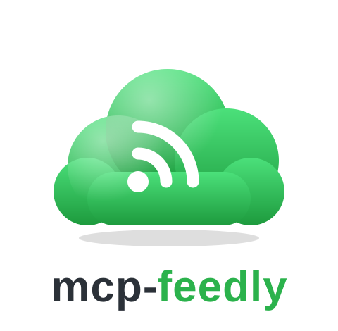

<p align="center">
  
</p>

<p align="center"><b>Version 1.2.0</b> &middot; Python &middot; MCP over stdio or bearer-protected HTTP</p>

An MCP (Model Context Protocol) server that gives Claude, Codex and any MCP client full access to your Feedly account: read and search articles, save and tag them, organize subscriptions and categories, and import/export OPML.

- **32 tools** (read, search, write, auth, status)
- **Plain Python:** the whole server and every support script is `.py` - no compiled launchers, no bytecode shipped
- **Self-renewing authentication:** when the Feedly access token expires, the server renews it from a refresh token, stores the new one in your user environment and logs the event
- **Small distributable zip** (about 70 KB, pure Python, no bundled libraries) with a manifest, checksum and verification report; dependencies install with one command
- **Setup wizard** (GUI) and console setup scripts

> This is a local development project (it will become a fork of the original Feedly MCP server later). Nothing here needs, or documents, a download from GitHub.

---

## Contents

1. [Project layout](#1-project-layout)
2. [Quick start (development)](#2-quick-start-development)
3. [Feedly tokens: get, renew, rotate](#3-feedly-tokens-get-renew-rotate)
4. [Setup wizard and support scripts](#4-setup-wizard-and-support-scripts)
5. [Connecting clients](#5-connecting-clients)
6. [HTTP transport with bearer auth](#6-http-transport-with-bearer-auth)
7. [Tool reference](#7-tool-reference)
8. [Version, status and manifest](#8-version-status-and-manifest)
9. [Distribution](#9-distribution)
10. [Configuration reference](#10-configuration-reference)
11. [Testing](#11-testing)
12. [Troubleshooting](#12-troubleshooting)
13. [Security notes](#13-security-notes)

---

## 1. Project layout

```
mcp-feedly/
├── feedly_mcp_server.py      # the MCP launcher (python feedly_mcp_server.py)
├── feedly_mcp/               # the MCP server package (all .py)
│   ├── server.py             #   FastMCP app, 32 tools, stdio/HTTP entry point, bearer middleware
│   ├── client.py             #   Feedly API client: error mapping, 401 -> renew -> retry
│   ├── auth.py               #   TokenManager: renewal through the refresh token
│   ├── persist.py            #   saves renewed tokens to the user environment + audit log
│   ├── models.py             #   Pydantic input models
│   ├── constants.py
│   └── __init__.py           #   __version__ (single source of the version)
├── requirements.txt          # the Python dependencies (kept in sync with pyproject.toml)
├── scripts/                  # ALL support scripts, all Python
│   ├── _common.py            #   shared helpers
│   ├── setup_wizard.py       #   GUI wizard
│   ├── install_dependencies.py #  install requirements.txt (or create the local .venv)
│   ├── set_feedly_token.py   #   save the Feedly tokens (interactive / --silent)
│   ├── setup_claude.py       #   register in Claude Desktop
│   ├── setup_codex.py        #   register in Codex
│   └── build_distribution.py #   build the distributable zip in distribution/
├── setup_wizard.bat          # .bat files only call the matching scripts/*.py
├── install_dependencies.bat
├── set_feedly_token.bat
├── setup_claude.bat
├── setup_codex.bat
├── build_distribution.bat
├── assets/logo.svg
├── tests/                    # offline test suites
├── CHANGELOG.md  README.md  LICENSE  pyproject.toml
│
├── .venv/                    # LOCAL support environment only (dev and build); never shipped
└── distribution/             # BUILD OUTPUT: the distributable zip + .sha256 + VERIFICATION.json + README.txt
```

Rules of the layout:

- **`.venv`** holds only local support things (the interpreter environment used to develop, test and build). The product does not depend on it: the setup scripts register the system Python.
- **`distribution/`** holds the distributable zip: only this project's own Python files (about 70 KB). **No third-party library is bundled** - `requirements.txt` lists the four dependencies and is installed once on the target machine.
- **There is no release folder and no `lib/` folder.** The build assembles the package in a temporary staging folder, verifies it, zips it and deletes the staging folder.
- **Scripts are Python**, live in `scripts/`; the `.bat` files are one-screen launchers that call them.
- **The MCP is Python in the project root** (`feedly_mcp_server.py` + `feedly_mcp/`).

---

## 2. Quick start (development)

Requires Python 3.10+ (the build script needs 3.11+) and a Feedly account with developer-token access (a Pro plan works).

```bash
python -m venv .venv
.venv\Scripts\python -m pip install -e .
python scripts/setup_wizard.py
```

(or simply double-click `setup_wizard.bat` - step 1 of the wizard can create `.venv` for you).

Run the server directly:

```bash
python feedly_mcp_server.py                 # stdio (what MCP clients use)
python feedly_mcp_server.py --version       # prints: feedly-mcp 1.2.0
python feedly_mcp_server.py --transport http --port 8000   # HTTP, see section 6
```

Prefer to do it by hand? Get your tokens ([section 3](#3-feedly-tokens-get-renew-rotate)), save them as user environment variables, and register the launcher in your client ([section 5](#5-connecting-clients)).

---

## 3. Feedly tokens: get, renew, rotate

### 3.1 Where to get the tokens

| What | Where |
|------|-------|
| **Token page (get or regenerate both tokens)** | [https://feedly.com/v3/auth/dev](https://feedly.com/v3/auth/dev) |
| **Renewal endpoint (used automatically by the server)** | `POST https://cloud.feedly.com/v3/auth/token` |

Steps:

1. Sign in to Feedly in your browser.
2. Open the token page: [https://feedly.com/v3/auth/dev](https://feedly.com/v3/auth/dev)
3. Copy the **access token** and the **refresh token** shown there.
4. Store them using one of these methods:
   - run `setup_wizard.bat` (recommended), or
   - run `set_feedly_token.bat` (prompts for both; what you type is visible), or
   - set the user environment variables yourself: `FEEDLY_ACCESS_TOKEN` and `FEEDLY_REFRESH_TOKEN`.
5. Fully quit and restart your client (Claude Desktop / Codex / terminal) so it picks up the changes.

If the token page shows an error or no token, Feedly may restrict API access on your plan; contact Feedly support. Treat both tokens like passwords and never paste them into chat.

### 3.2 How the lifecycle works

- The **access token** is the credential sent with every Feedly request (`Authorization: Bearer ...`). It expires; in practice after about **31 days** (the log records the exact expiry on each renewal).
- The **refresh token** is a longer-lived credential that can only be exchanged for new access tokens.
- Expiry is implicit: nothing tells the server in advance; the first request after expiry simply returns HTTP 401.

### 3.3 The automatic renewal process

```
tool call
   |
   v
send request with current access token
   |
   +-- 200 --------------------------------------------> return result
   |
   +-- 401 and FEEDLY_REFRESH_TOKEN is set
         |
         v
   POST /v3/auth/token   { refresh_token, client_id, client_secret,
         |                 grant_type: "refresh_token" }
         |
         +-- failure --> log TOKEN_REFRESH_FAILED, return a clear error
         |
         +-- success --> new access token (kept in memory)
               |
               +-- save it as the user-level FEEDLY_ACCESS_TOKEN
               |   (scripts/set_feedly_token.py --silent), replacing the old one
               +-- if Feedly rotated the refresh token, save that too
               +-- append a line to feedly-mcp-token.log
               |
               v
         retry the original request once -------------> return result
```

Details:

- Several concurrent 401s trigger **one** renewal; the others reuse the new token.
- With only a refresh token set (no access token), the server fetches an access token on first use.
- The client credentials sent are Feedly's public developer client (`feedlydev` / `feedlydev`); override with `FEEDLY_CLIENT_ID` / `FEEDLY_CLIENT_SECRET` if you use your own Feedly app.
- Saving the token never blocks or fails a request: if saving fails, the new token still works in memory and the failure is logged.
- Token values are **never** written to the log or returned by any tool.

Force a renewal with the `feedly_refresh_access_token` tool; check status with `feedly_auth_status`.

### 3.4 The renewal log

`feedly-mcp-token.log` in the project (or installed copy) folder, one line per event, metadata only:

```
2026-11-19T23:47:26+01:00 TOKEN_REFRESHED persisted=user-env-updated detail=exit=0 access_len=388 refresh_rotated=False expires_at=2026-12-20_23:47:26+0100
2026-11-20T09:01:02+01:00 TOKEN_REFRESH_FAILED http_status=400 feedly_message='bad refresh_token'
```

| Field | Meaning |
|-------|---------|
| `persisted` | `user-env-updated` (saved), `FAILED` (see `detail`), or `disabled` |
| `refresh_rotated` | Feedly issued a new refresh token and it was saved |
| `expires_at` | Local date/time the new access token expires |

Override the location with `FEEDLY_MCP_LOG`; disable saving to the environment with `FEEDLY_PERSIST_TOKEN=0`.

### 3.5 When the refresh token itself stops working

You will see `Token refresh failed (HTTP ...)` and a `TOKEN_REFRESH_FAILED` log line. Generate a new pair at [https://feedly.com/v3/auth/dev](https://feedly.com/v3/auth/dev) and store it with the wizard or `set_feedly_token.bat`.

### 3.6 Notes on "already running" programs

Windows only gives user-environment changes to programs started *afterwards*. The server does not depend on that: it re-reads the user environment from the registry itself and keeps the renewed token in memory. A client that is already open just keeps its old variables until restart, which is harmless.

---

## 4. Setup wizard and support scripts

Every script is Python in `scripts/`; each `.bat` in the project root only locates Python (the local `.venv` first, then `python` on PATH) and calls the matching script, passing its arguments through.

| Launcher | Script | What it does |
|----------|--------|--------------|
| `setup_wizard.bat` | `scripts/setup_wizard.py` | GUI wizard: checks, dependencies, tokens, registration, live test |
| `install_dependencies.bat` | `scripts/install_dependencies.py` | Install `requirements.txt` (`--check` only verifies, `--python PATH` targets an interpreter) |
| `set_feedly_token.bat` | `scripts/set_feedly_token.py` | Save the Feedly tokens as user environment variables |
| `setup_claude.bat` | `scripts/setup_claude.py` | Register / `--remove` the server in Claude Desktop |
| `setup_codex.bat` | `scripts/setup_codex.py` | Register / `--remove` the server in Codex |
| `build_distribution.bat` | `scripts/build_distribution.py` | Build the distributable zip in `distribution/` |

### 4.1 The GUI wizard

Standard library + tkinter only. Five steps:

1. **Checks** - Python, server files, and whether the dependencies are installed. Offers "Install dependencies now" (source layout: creates the local `.venv`; extracted zip: installs `requirements.txt` into the Python running the wizard).
2. **Feedly tokens** - visible fields (untick "Show tokens" to mask them), a button that opens the token page, optional **Validate** (read-only call; uses the refresh token if the access token expired). Blank keeps the stored value.
3. **Where to install** - tick Claude Desktop and/or Codex; choose whether to save the tokens.
4. **Review & apply** - shows the plan (including the token values you entered), then applies it with a step log that shows what was saved.
5. **Test & finish** - starts the server, lists tools and calls Feedly (`feedly_auth_status`).

### 4.2 What the setup scripts modify

Always after creating a `<file>.bak-<timestamp>` backup. **Both clients get the same command: the system Python's windowless interpreter (`pythonw`, so no console window appears) plus the launcher.** The Python chosen is the first one that has the dependencies: the system (base) Python, then - in the source layout only - the local `.venv`.

| Target | File | Change |
|--------|------|--------|
| Claude Desktop | `%APPDATA%\Claude\claude_desktop_config.json` | adds/updates `mcpServers.feedly` (`command` + `args` only); all other servers and settings untouched |
| Codex | `%USERPROFILE%\.codex\config.toml` | replaces `[mcp_servers.feedly]` (other tables untouched, result validated as TOML) |
| Tokens | user environment (Windows registry) | `FEEDLY_ACCESS_TOKEN` / `FEEDLY_REFRESH_TOKEN` |

The Codex block is written exactly like this (no `env_vars`, no secrets):

```toml
[mcp_servers.feedly]
command = 'C:\Python\pythonw.exe'
args = ['C:\path\to\mcp-feedly\feedly_mcp_server.py']
startup_timeout_sec = 30
tool_timeout_sec = 120
```

and the Claude Desktop entry is:

```json
"feedly": {
  "command": "C:\\Python\\pythonw.exe",
  "args": ["C:\\path\\to\\mcp-feedly\\feedly_mcp_server.py"]
}
```

No token is ever written into a client config: the server reads `FEEDLY_*` from the user environment (registry) itself, which is why neither client needs to pass variables through.

### 4.3 Console usage

```bash
python scripts/install_dependencies.py            # install / verify (add --python PATH for another interpreter)
python scripts/setup_claude.py                    # register (--test: live check, --remove: undo)
python scripts/setup_codex.py                     # same for Codex
python scripts/set_feedly_token.py                # prompts (visible input), validates, saves
python scripts/set_feedly_token.py --silent       # used by the server after a renewal (reads FEEDLY_NEW_* from the environment)
```

---

## 5. Connecting clients

The server reads `FEEDLY_ACCESS_TOKEN` / `FEEDLY_REFRESH_TOKEN` from its environment and, on Windows, falls back to the user environment in the registry, so client configs need no secrets and no `env` block. Easiest: run the wizard or `setup_claude.bat` / `setup_codex.bat`. Manual equivalents:

### Claude Desktop

Add under `mcpServers` in `%APPDATA%\Claude\claude_desktop_config.json` (keep your other servers), then fully quit and restart Claude Desktop:

```json
{
  "mcpServers": {
    "feedly": {
      "command": "C:\\Python\\pythonw.exe",
      "args": ["C:\\path\\to\\mcp-feedly\\feedly_mcp_server.py"]
    }
  }
}
```

### Codex

In `%USERPROFILE%\.codex\config.toml`:

```toml
[mcp_servers.feedly]
command = 'C:\Python\pythonw.exe'
args = ['C:\path\to\mcp-feedly\feedly_mcp_server.py']
startup_timeout_sec = 30
tool_timeout_sec = 120
```

### Notes for both

- `pythonw` is the windowless Python interpreter: MCP stdio works through it and no console window pops up. Use `python` instead if you ever need to see the server's console.
- The Python that `command` points to must have the dependencies installed. Check with `python scripts/install_dependencies.py --check`, install into the system Python with `python scripts/install_dependencies.py --python C:\Python\python.exe` (or `C:\Python\python.exe -m pip install -r requirements.txt`).
- `args` points at the launcher: the project root, or the folder you extracted the zip to.

### Any other stdio client

Command `python` (or `pythonw`), argument the full path of `feedly_mcp_server.py`.

---

## 6. HTTP transport with bearer auth

```bash
export MCP_BEARER_TOKEN=$(python -c "import secrets; print(secrets.token_urlsafe(32))")
python feedly_mcp_server.py --transport http --host 127.0.0.1 --port 8000
```

- Endpoint: `http://HOST:PORT/mcp` (streamable HTTP).
- Every request must carry `Authorization: Bearer <MCP_BEARER_TOKEN>`; otherwise the answer is `401` with `WWW-Authenticate: Bearer`.
- `MCP_BEARER_TOKEN` (at least 16 characters) is mandatory; the server refuses to start without it. It is the token *clients* use to reach the server and is unrelated to the Feedly tokens.
- Binds to loopback by default. If you bind elsewhere, put TLS in front (reverse proxy): the bearer token travels in clear text over plain HTTP.
- Environment equivalents: `MCP_TRANSPORT`, `MCP_HOST`, `MCP_PORT`.

---

## 7. Tool reference

All tools accept `response_format` (`markdown` default, or `json`) unless noted. IDs for tags and categories may be given as a bare label (`Research`) or a full ID (`user/{userId}/tag/Research`). Output is truncated at 100,000 characters; use `compact`, `limit`/`offset` or `continuation` for large results. Destructive tools carry `destructiveHint` so clients can ask for confirmation.

### Stream ID formats

| Stream | ID |
|--------|----|
| Feed | `feed/https://example.com/rss` |
| Category | `user/{userId}/category/{label}` |
| Tag | `user/{userId}/tag/{label}` |
| All articles | `user/{userId}/category/global.all` |
| Saved for later | `user/{userId}/tag/global.saved` |

Get your `userId` with `feedly_get_profile`.

### Status, account and authentication

| Tool | Purpose |
|------|---------|
| `feedly_status` | Version, Python/platform, transport, uptime, tool inventory, token flags, distribution build summary (no Feedly call, no secrets, no paths) |
| `feedly_get_profile` | Profile and user ID |
| `feedly_auth_status` | Whether the token works and auto-renew is available (never reveals tokens) |
| `feedly_refresh_access_token` | Force a renewal now (normally automatic on 401) |

### Reading

| Tool | Purpose | Main parameters |
|------|---------|-----------------|
| `feedly_get_subscriptions` | List feeds | `query`, `limit` (1-500), `offset`, `compact` |
| `feedly_get_categories` | List categories/folders | - |
| `feedly_get_tags` | List tags/boards | - |
| `feedly_get_unread_counts` | Unread count per stream | - |
| `feedly_get_stream_contents` | Articles from a feed/category/tag | `stream_id`, `count` (1-100), `unread_only`, `continuation`, `ranked`, `newer_than`, `older_than`, `compact` |
| `feedly_get_entry` | One article incl. content | `entry_id` |
| `feedly_get_entries` | Many articles (batch, max 1000) | `entry_ids` |
| `feedly_get_feed` | Feed metadata (subscribers, velocity, ...) | `feed_id` |
| `feedly_get_most_engaging` | "Must read" articles of a stream | `stream_id`, `count`, `unread_only`, `hours`, `compact` |
| `feedly_get_recent_reads` | IDs recently marked read | `count`, `newer_than` |

### Search and discovery

| Tool | Purpose | Main parameters |
|------|---------|-----------------|
| `feedly_search_feeds` | Find feeds by keyword, `#topic` or URL | `query`, `count`, `locale` |
| `feedly_search_contents` | Full-text search inside a stream (Feedly Pro) | `stream_id`, `query`, `count`, `unread_only`, `continuation`, `newer_than`, `compact` |

### Read state and saved items

| Tool | Purpose | Parameters |
|------|---------|------------|
| `feedly_mark_as_read` | Mark articles read | `entry_ids` (max 1000) |
| `feedly_mark_feed_as_read` | Mark a whole feed read | `feed_id`, `as_of` |
| `feedly_mark_category_as_read` | Mark a whole category read | `category_id`, `as_of` |
| `feedly_keep_unread` | Undo mark-as-read | `entry_ids` |
| `feedly_save_entries` | Save for later | `entry_ids` |
| `feedly_unsave_entries` | Remove from saved | `entry_ids` |

### Tags and boards

| Tool | Purpose | Parameters |
|------|---------|------------|
| `feedly_tag_entries` | Add tags (created if missing) | `tags`, `entry_ids` |
| `feedly_untag_entries` | Remove tags from articles | `tags`, `entry_ids` |
| `feedly_rename_tag` | Rename a tag | `id`, `new_label` |
| `feedly_delete_tag` *(destructive)* | Delete a tag (articles stay) | `id` |

### Subscriptions and categories

| Tool | Purpose | Parameters |
|------|---------|------------|
| `feedly_subscribe` | Subscribe; also updates title and **replaces** categories of an existing subscription (moves a feed between folders) | `feed_id` (`feed/URL` or bare URL), `title`, `categories` |
| `feedly_unsubscribe` *(destructive)* | Unsubscribe | `feed_id` |
| `feedly_rename_category` | Rename a category | `id`, `new_label` |
| `feedly_delete_category` *(destructive)* | Delete a category (feeds become uncategorized) | `id` |

### OPML

| Tool | Purpose | Parameters |
|------|---------|------------|
| `feedly_export_opml` | Export all subscriptions as OPML XML | - |
| `feedly_import_opml` | Import subscriptions from OPML | `opml` (XML text) |

### Typical workflow

1. `feedly_get_profile` - note the user ID.
2. `feedly_get_unread_counts` - see what has news.
3. `feedly_get_stream_contents` with `compact=true` - scan titles.
4. `feedly_get_entry` / `feedly_get_entries` - read what matters.
5. `feedly_tag_entries` / `feedly_save_entries` - keep it; `feedly_mark_as_read` - clear the rest.

---

## 8. Version, status and manifest

The version has a single source, `__version__` in `feedly_mcp/__init__.py`, and is reported everywhere:

| Where | How |
|-------|-----|
| Command line | `python feedly_mcp_server.py --version` prints `feedly-mcp 1.2.0` |
| MCP handshake | the `serverInfo.version` the server sends on `initialize` (not the SDK's version) |
| `feedly_status` tool | version, Python, platform, transport, uptime, tool counts, token flags, distribution summary |
| `manifest.json` | inside every distribution zip |
| File names | `distribution/feedly-mcp-1.2.0.zip` |
| `CHANGELOG.md` | one `## [x.y.z]` section per version (a test checks it matches the code) |

### manifest.json

Generated by the build and shipped inside the zip; it records:

| Field | Content |
|-------|---------|
| `name`, `display_name`, `version`, `description`, `license` | identity |
| `built_at`, `target`, `python.minimum`, `python.built_with` | build time (UTC); `target` is `any` (pure Python); minimum Python and the Python the build ran on |
| `entry` | launcher, command/args, transports (`stdio`, `http`), HTTP endpoint and auth |
| `requirements` | the requirements file, the package specifiers and the install command |
| `environment` | variables the server reads (required / optional) |
| `tools` | count, read-only count, destructive count, sorted list of names (taken from a real `tools/list`) |
| `scripts` | the support scripts shipped |
| `files` | path, size and SHA-256 of every file in the package |

---

## 9. Distribution

```bash
build_distribution.bat            # or: .venv\Scripts\python scripts\build_distribution.py
```

### 9.1 What is in the zip

```
feedly-mcp-<version>/
├── feedly_mcp_server.py    launcher
├── feedly_mcp/             the MCP (Python source)
├── requirements.txt        the dependencies to install (mcp, httpx, pydantic, uvicorn)
├── scripts/                the six support scripts (all Python)
├── *.bat                   launchers for the scripts
├── manifest.json  README.md  CHANGELOG.md  LICENSE  assets/
```

It contains **no third-party libraries**, no tests, no `.venv`, no build tooling, no logs, no bytecode (`.pyc` / `__pycache__`), no local paths and no credentials.

### 9.2 The `distribution/` folder

```
distribution/
├── feedly-mcp-1.2.0.zip          the distributable (about 70 KB)
├── feedly-mcp-1.2.0.zip.sha256
├── VERIFICATION.json             result of the build checks
└── README.txt                    install notes for the recipient
```

The package is pure Python, so the same zip works with any Python 3.10 or newer on any machine; only the dependencies are installed on the target.

### 9.3 What the build verifies (`VERIFICATION.json`)

All checks must pass (the script fails otherwise); they run on the staged package, on the **extracted zip**, and in a **clean room**:

| Check | Meaning |
|-------|---------|
| `starts_with_declared_dependencies` | the package starts (isolated `-I -B`, no credentials), completes the MCP handshake and lists its tools |
| `handshake_version_matches_package` | the MCP handshake reports the package version |
| `status_tool_matches_package_version` / `status_tool_reads_manifest` | `feedly_status` agrees with the package and finds the manifest |
| `plain_python_no_bytecode` | no `.pyc` / `__pycache__` anywhere in the package |
| `no_third_party_libraries_bundled` | no `lib`, `site-packages` or `*.dist-info` in the package |
| `manifest_hashes_match_package` | every SHA-256 in the manifest matches the file |
| `no_local_paths_identity_or_credentials` | no user paths/names or token-like strings in the shipped text files |
| `no_dev_files_in_package` | no `.venv`, tests, build script, logs |
| `requirements_match_pyproject` | `requirements.txt` equals the dependencies declared in `pyproject.toml` |
| `zip_integrity`, `extracted_copy_starts`, `extracted_copy_matches_manifest` | the zip is sound and its extracted copy works and matches the manifest |
| `fresh_environment_install_works`, `fresh_environment_lists_all_tools` | **clean room:** a brand-new virtual environment gets *only* `requirements.txt` installed, then runs the extracted package and exposes every tool - this proves the dependency list is sufficient (`--skip-clean-install` skips it for quick local builds) |

### 9.4 Installing from the zip

1. Extract the whole zip to a stable folder (the path is stored in the client configuration).
2. Install Python 3.10 or newer if needed.
3. Double-click `setup_wizard.bat`: step 1 installs the dependencies, then it saves the tokens and registers Claude Desktop / Codex. (Console equivalents: `install_dependencies.bat`, `set_feedly_token.bat`, `setup_claude.bat`, `setup_codex.bat`.)
4. Fully quit and restart the client.

Check the download with the `.sha256` file (`certutil -hashfile <zip> SHA256`). Dependencies are downloaded by pip, so the target machine needs internet access (or a pip mirror) once.

### 9.5 On the development machine

No installation step is needed: the setup scripts register the **system Python's `pythonw` plus the launcher in the project root**, so the clients run the source directly and code changes are live after a client restart. `.venv` is used only for tests and builds. The zip is for other machines.

---

## 10. Configuration reference

| Variable | Default | Purpose |
|----------|---------|---------|
| `FEEDLY_ACCESS_TOKEN` | - | Feedly access token (optional if a refresh token is set) |
| `FEEDLY_REFRESH_TOKEN` | - | Enables automatic renewal |
| `FEEDLY_CLIENT_ID` / `FEEDLY_CLIENT_SECRET` | `feedlydev` | Client credentials for the renewal exchange |
| `FEEDLY_PERSIST_TOKEN` | `1` | `0` disables saving renewed tokens to the user environment |
| `FEEDLY_MCP_LOG` | `<root>/feedly-mcp-token.log` | Renewal log path |
| `MCP_TRANSPORT` | `stdio` | `stdio` or `http` |
| `MCP_HOST` / `MCP_PORT` | `127.0.0.1` / `8000` | HTTP bind address |
| `MCP_BEARER_TOKEN` | - | Required for HTTP; min. 16 characters |

Command line: `python feedly_mcp_server.py [--version] [--transport stdio|http] [--host HOST] [--port PORT]`.

---

## 11. Testing

```bash
.venv\Scripts\python tests\test_offline.py     # 12 tests: client, renewal, persistence, tools, HTTP auth
.venv\Scripts\python tests\test_scripts.py     # 15 tests: setup scripts, Codex/Claude entries, launchers, version, requirements, build helpers
.venv\Scripts\python scripts\setup_wizard.py --selftest    # the wizard UI builds headlessly
```

All tests are offline (mocked HTTP) and cannot change your real environment, log or client configs. Not covered by automated tests: live write operations (tag, save, subscribe, unsubscribe, delete, OPML import) - try those on disposable data first. The distribution build adds its own checks (section 9.3).

---

## 12. Troubleshooting

| Symptom | Cause / fix |
|---------|-------------|
| `Authentication failed. Check FEEDLY_ACCESS_TOKEN (and set FEEDLY_REFRESH_TOKEN ...)` | Token expired and no refresh token available: get a new pair at [https://feedly.com/v3/auth/dev](https://feedly.com/v3/auth/dev) |
| `Token refresh failed (HTTP 400/401 ...)` | Refresh token expired or wrong: generate a new pair and save it with the wizard or `set_feedly_token.bat` |
| `Access forbidden. Check your Feedly plan.` (403) | The feature needs a higher Feedly plan (e.g. `feedly_search_contents` needs Pro) |
| `Rate limit exceeded` (429) | Wait and retry; reduce batch sizes |
| `No module named 'mcp.server.fastmcp'` | Wrong `mcp` version in the local `.venv`: recreate it (`pip install -e .` pins `mcp<2`) |
| `ModuleNotFoundError` (mcp, httpx, pydantic, uvicorn) or the client says the server failed to start | The Python in the client config lacks the dependencies: `python scripts/install_dependencies.py --check`, then `python scripts/install_dependencies.py --python <that python>` |
| Client starts but the server has no token | Save the tokens with the wizard / `set_feedly_token.bat`, then fully quit and restart the client. The server also reads the user environment from the registry itself, so no `env` block or `env_vars` is needed |
| `persisted=FAILED` in the log | `scripts/set_feedly_token.py` is missing or blocked; the token still works in memory. Re-run the wizard |
| Lists look cut off | Output cap of 100,000 characters: use `compact`, `limit`/`offset` or `continuation` |
| HTTP: `401 unauthorized` | Missing or wrong `Authorization: Bearer <MCP_BEARER_TOKEN>` header |

---

## 13. Security notes

- Both Feedly tokens grant access to your account. Keep them in user environment variables (as the wizard does), never in files under version control. The log never contains token values.
- The server only talks to `cloud.feedly.com`.
- Write and delete tools act on your real account; clients should confirm destructive calls.
- In HTTP mode, use a long random `MCP_BEARER_TOKEN`, bind to loopback unless needed, and add TLS for anything beyond localhost.
- Client configs written by the setup scripts contain no secrets; backups (`*.bak-*`) are copies of those config files.
- The distribution build refuses to ship local paths, user names or token-like strings.

---

## License

GPL-3.0 License
